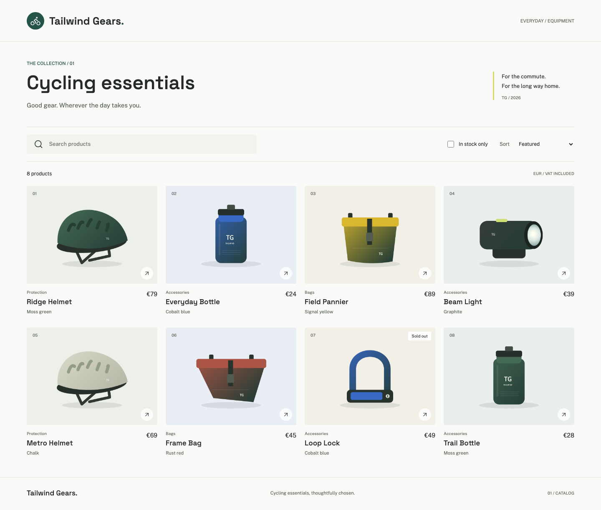

# Tailwind Gears

A small cycling catalog for **Accelerate DevOps with GitHub, second edition**. One application to plan, change, test, review, and eventually deploy. It is a fictional teaching sample, not a real shop or production-ready commerce service.



## Fork the sample

Use your own fork for the book exercises. Keep your issues, branches, and pull requests there; do not submit the intentional bug fix to the author's repository.

1. Sign in to GitHub and open [wulfland/tailwind-gears](https://github.com/wulfland/tailwind-gears).
2. Select **Fork**, choose your account as **Owner**, and keep the name `tailwind-gears`. Copying the default branch is sufficient. Select **Create fork**.
3. In **your fork**, open **Settings**, then **General**. Under **Features**, enable **Issues** if it is not already selected. Forking does not copy the author's issues or create a GitHub Project for you.
4. Open **Code** in your fork and copy its clone URL. Replace `YOUR-USERNAME` below with your account (and adjust the repository name if you changed it).

```sh
git clone https://github.com/YOUR-USERNAME/tailwind-gears.git
cd tailwind-gears
git remote -v
```

Confirm that `origin` points to **your fork**, not `wulfland/tailwind-gears`. Open the cloned folder in your editor, then follow **Run locally** below. See GitHub's [forking guide](https://docs.github.com/en/pull-requests/how-tos/work-with-forks/fork-a-repo) for Git setup and authentication help.

Your fork of this public repository is public too. Use only the supplied fictional data and approved exercise notes. Do not add company code, meeting transcripts, personal data, or credentials. If your organization requires private practice, use an approved independent private repository instead of a public fork.

When you reach the implementation exercise, create a branch in your fork. Open its pull request against **your fork's `main` branch**; check the **base repository** because GitHub may offer the author's upstream repository. You do not need to sync from upstream during the exercise.

## Run locally

Use Node.js 24 LTS and npm. No database, cloud account, secrets, or AI subscription is required.

```sh
npm ci
npm run dev
```

Open <http://localhost:5173>. The same process serves the API and frontend. If that port is occupied, set `PORT` to another port before running the command (for example `PORT=5174 npm run dev` on macOS/Linux, or `$env:PORT=5174; npm run dev` in PowerShell).

To run the built application:

```sh
npm run build
npm start
```

The server binds to loopback by default. Set `HOST=0.0.0.0` only when you intend to expose it, such as in a container. Keep development servers private.

## Intentional teaching bug

**Search is case-sensitive in the starting version.** `Helmet` finds two helmets; `HELMET` and `helmet` find none. This is deliberate. Normal tests pass because they describe the existing supported behavior, not because the application is defect-free.

```sh
npm run test:exercise
```

This command **must fail on the starting version**. It expresses the desired case-insensitive behavior. Fixing it is the bounded Chapter 2 agent exercise. Add permanent regression tests when you implement the fix; do not remove or relax the exercise assertion.

Category filtering is a separate, unimplemented feature for planning. Categories are already present in the data. Search, price/name sorting, stock filtering, empty/error states, URL state, and accessible product details work without it.

Start with the [Chapter 2 exercise](docs/chapter-02/README.md), [two-issue backlog](docs/chapter-02/backlog.json), and [fictional meeting transcript](docs/chapter-02/meeting-transcript.md). Create the two issues in your fork, either manually from the drafts or with the preview-first commands in the exercise guide. Do not run exercises in the author's issue tracker.

Continue with the [Chapter 3 review exercise](docs/chapter-03/README.md) to inspect the proposed search fix, assess optional Copilot assistance, and merge and verify the change in your own fork. The guide includes both solo self-review and independent-review requirements.

The [Chapter 4 optional activities](docs/chapter-04/README.md) cover written handoffs, choosing collaboration tools, reproducing the sample in Codespaces, and a documentation-only agent task. They work with the unfixed baseline or a corrected fork; do not repeat the search fix or implement the unresolved category feature for that chapter.

The [Chapter 11 optional activities](docs/chapter-11/README.md) cover reading and running the CI workflow, adding an Arm job, promoting a build through `staging` and `production` environments with a required reviewer, drafting a workflow change with Copilot against an instructions file, investigating a failed CI run with a GitHub Agentic Workflow, and summarizing commits with Copilot CLI inside a workflow. The reference workflow files are in `docs/chapter-11/workflows/`; nothing runs until you copy a file into your fork's `.github/workflows/`. The Copilot activities need a Copilot plan; the agentic workflow and the Copilot CLI activities consume AI credits from a paid plan.

The [Chapter 12 optional activities](docs/chapter-12/README.md) cover protecting `main` with a ruleset, merging a change through a short-lived branch with auto-merge, deploying a small behavior change dark behind a feature flag (a registry in `server/flags.ts` with an owner, an expiry, and a default, overridden per process through the `TG_FLAGS` environment variable and per deployment environment through an Actions variable), releasing it through a Copilot cloud agent pull request under the same rules, and retiring it with an expiry check and a cleanup pull request. The reference files are in `docs/chapter-12/flags/`; the baseline does not contain the flag. Readers who complete every activity end with a fork whose featured order always shows sold-out products last. The two agent activities need a paid Copilot plan and consume AI credits; each has a manual alternative.

The [Chapter 13 optional activities](docs/chapter-13/README.md) cover mapping the sample's test files onto the levels of the test pyramid with their timings and coverage, adding a coverage gate to the CI workflow and a scheduled reliability run that repeats the browser suite, running a chaos experiment on your machine with a small fault injector (`TG_CHAOS=products-503:3` fails every third catalog list request) and its tests, and generating tests with Copilot and keeping only the ones a hand-made mutation can break. The reference files are in `docs/chapter-13/chaos/` and `docs/chapter-13/workflows/`; the baseline does not contain the injector or the reliability workflow, and the injector does nothing while the variable is unset. The first three activities cost nothing; the fourth needs a Copilot plan and has a manual alternative.

The [Chapter 14 optional activities](docs/chapter-14/README.md) cover writing a threat model for the catalog with four abuse-case tests that pin properties the API already has, running a tabletop drill for a compromised contributor against the fork's real settings without executing anything, hardening the dev container configuration so that a codespace runs as a non-root user with one labeled private port and no access beyond its repository, and reviewing an assistant's proposed image endpoint against a checklist and a path-traversal test. The reference files are in `docs/chapter-14/security/` and `docs/chapter-14/devcontainer/`; the baseline does not contain them. The first two activities cost nothing, the third uses the Codespaces quota, and the fourth needs a Copilot plan and has a manual alternative.

The [Chapter 16 optional activities](docs/chapter-16/README.md) cover pinning the catalog's module boundaries with a fitness function (a test that reads the source files and fails when the browser code imports server code or the contract imports anything), growing a replacement search beside the old one with a parity test that proves the two identical and a `TG_SEARCH=next` switch that routes to it only when asked, writing an architecture note with an assistant and checking every claim against the file and line it cites, and running a three-shard refactoring that moves the API routes into `server/routes/` modules, with the first shard done by hand as the exemplar and the other two by an agent under a written recipe and deterministic gates. The reference files are in `docs/chapter-16/boundaries/`, `docs/chapter-16/strangler/`, and `docs/chapter-16/refactoring/`; the baseline does not contain them, and none of the activities changes the search behavior. The first two activities cost nothing; the third needs a Copilot plan or Claude Code and the fourth a paid Copilot plan or Claude Code, each with a manual alternative.

## Verify

```sh
npm run check
npx playwright install chromium
npm run test:e2e
```

`check` runs the unit/API/tooling tests and a strict TypeScript production build. Playwright starts a separate built server on port 5199, exercises desktop/mobile behavior, and saves screenshots in the ignored `test-results/` directory. Stop anything already using port 5199 before running it. The intentional acceptance failure is excluded from normal CI.

## Find the code

| Location | Responsibility |
| --- | --- |
| `server/catalog.ts` | Synthetic products and search/sort/filter behavior |
| `server/app.ts` | Express API and query validation |
| `server/index.ts` | Single-process development/production server |
| `shared/product.ts` | Product contract |
| `src/catalog.ts` | Browser UI and request handling |
| `src/catalog.css` | Responsive styling |
| `tests/`, `e2e/` | Unit, API, tooling, and browser regression tests |
| `exercises/` | Explicitly failing teaching checks |
| `scripts/seed-issues.ts` | Preview-first, repeatable issue creation |

API endpoints: `GET /api/health`, `GET /api/products?q=Helmet&sort=price-asc&inStock=true`, and `GET /api/products/ridge-helmet`. Supported sorts are `featured`, `name`, `price-asc`, and `price-desc`. Prices are integer euro cents. Product data is read-only and resets with the code; there is no checkout, inventory mutation, or persistence.

## Artwork and provenance

The product images are original programmatic PNG illustrations, not real product photography or third-party documentation images. They depict fictional products; sizes, materials, prices, and other specifications are synthetic fixtures, not safety or performance claims. Regenerate them with `npm run assets`. This sample does not reuse Tailwind Traders code or assets.

Lucide icons and the bundled Public Sans and Space Grotesk fonts retain their upstream licenses. `npm run build` copies their full notices to `public/licenses/third-party.txt` and the distributable. See [AI assistance and provenance](docs/AI_USE.md) before using this material in a publication. These web assets are not Packt manuscript figures.

The existing [book companion repository](https://github.com/wulfland/AccelerateDevOps) remains the first-edition resource hub. This repository is the independent second-edition application baseline.
